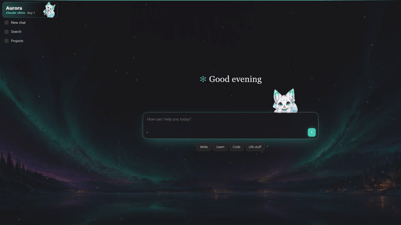
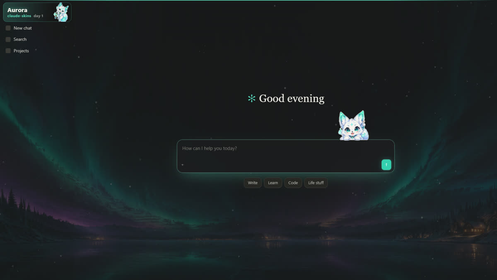
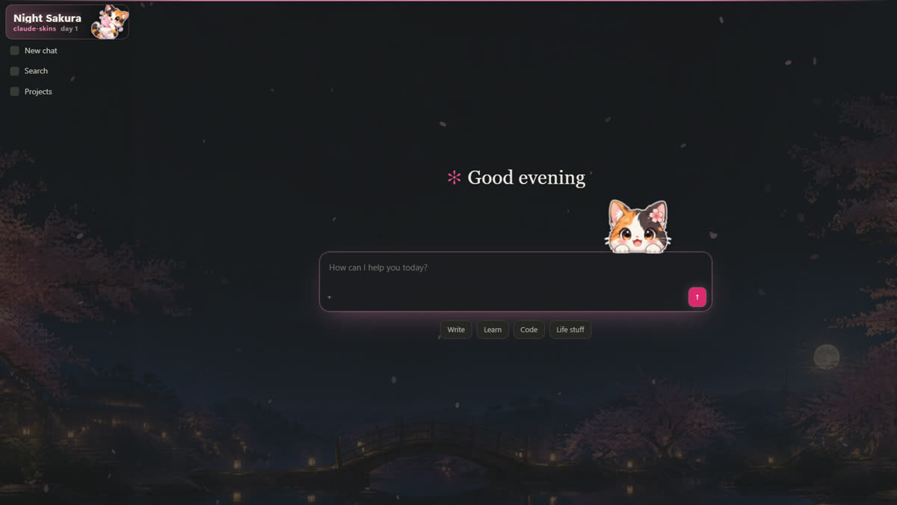
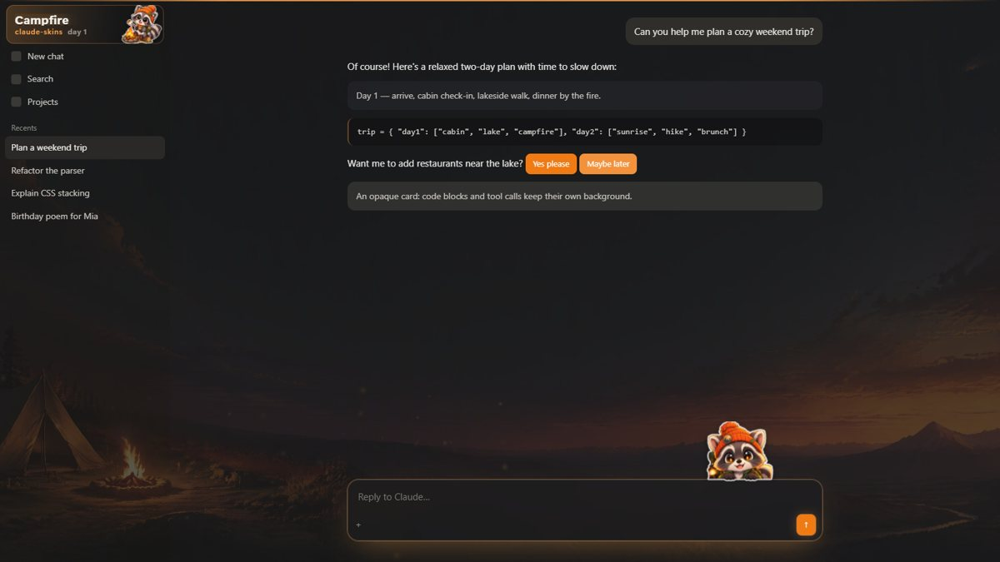
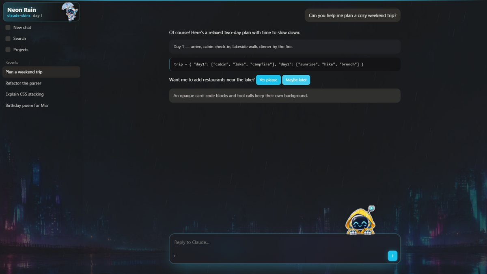

# claude-skins

[中文说明](README.zh-CN.md)

Themes for the Claude desktop app: a painted scene behind the chat, the accent color swapped to match, frosted-glass panels, gentle particles — and a little mascot that peeks over your message box, **hops along as you type, jumps when you hit Enter**, and can be clicked, dragged and flung around.



> **Unofficial.** claude-skins is a community project. It is not made, endorsed or supported by Anthropic. It patches the copy of Claude installed on *your* machine; no Anthropic files are redistributed here. Use it at your own risk, and expect to re-run the installer after Claude updates.

| Aurora | Night Sakura | Campfire | Neon Rain |
|---|---|---|---|
|  |  |  |  |

## Install

Requires [Node.js](https://nodejs.org) 22+. Quit Claude first (tray icon / menu → **Quit**, not just closing the window).

```bash
git clone https://github.com/JIA-ss/claude-skins.git
cd claude-skins
npm install --omit=dev   # dev dependencies (Electron) are only needed for the tests
node install.mjs
```

Start Claude again. That's it.

| Your Claude install | What the installer does |
|---|---|
| **Windows, Microsoft Store / MSIX** (the default download today) | The Store folder is read-only, so it copies the app to `%LOCALAPPDATA%\claude-skins\Claude`, patches the copy, and adds a Start menu shortcut **Claude (skins)**. Launch Claude from that shortcut. Your chats, login and settings are shared with the regular app. |
| **Windows, classic installer** (`%LOCALAPPDATA%\AnthropicClaude\app-*`) | Patches it in place. |
| **macOS** (`/Applications/Claude.app`) | Patches it in place and re-signs the bundle ad hoc. *Experimental — not tested by the author yet; reports welcome.* |
| Anything else | `node install.mjs --app <folder that contains resources/app.asar, or Claude.app>` |

Other commands:

```bash
node install.mjs status      # where Claude is, whether it is patched
node install.mjs uninstall   # put the original files back (Store version: delete the skinned copy + shortcut)
```

**After Claude updates**, run `node install.mjs` again (on the Store version it notices the new version and takes a fresh copy).

## Using it

| | |
|---|---|
| `Ctrl+Alt+T` | next theme (… → off → first theme) |
| `Ctrl+Alt+Shift+T` | intensity: how much of the scene shows through (low / medium / high) |
| click the sidebar banner | next theme |

The mascot:

- **Typing** — every keystroke it nods and takes a step along the top of the message box. Type faster and it builds momentum: longer strides, leaning forward, little dust puffs. Keep a streak going for a combo counter, random crits and callouts at 20 / 50 / 100 keys; your best streak is remembered.
- **Enter** — crouches and jumps; the more momentum, the higher (and a flip at full speed).
- **Click** — boing / head shake / hop with a speech bubble; three quick clicks make it dizzy.
- **Drag** — grab it anywhere, it swings with your movement and stays where you drop it. Drop it back near the message box (or double-click it) and it climbs back home.
- Clicks on its transparent parts go straight through to the page.

Light theme: only the accent color changes (the scene is designed for dark mode). Reduced motion (OS setting) turns off animations and particles.

## Make your own theme

A theme is a folder with a `skin.json`:

```json
{
  "name": { "en": "Aurora", "zh": "极光" },
  "order": 1,
  "hue": 168, "sat": 62,
  "line": "#5fe3c4",
  "background": "background.jpg",
  "peek": "peek.png",
  "badge": "badge.png",
  "fx": "snow", "fxColor": "#e6f7ff"
}
```

| Field | Meaning |
|---|---|
| `name` | string, or `{ "en", "zh" }` |
| `hue`, `sat` | accent color (HSL hue / saturation; lightness is kept from Claude's own palette) |
| `line` | highlight color for rings, the top line, bubbles |
| `background` | wide image (21:9 works well, e.g. 3840×1632). Keep the **center dark and empty** — text sits there. Omit for a generated gradient. |
| `peek` | transparent PNG of the mascot peeking over an edge (bottom edge flat). Omit for no mascot. |
| `badge` | transparent PNG for the sidebar banner |
| `fx` | particles: `snow`, `petals`, `embers`, `rain`, `spores`, or omit |
| `font` | optional `.woff2` / `.ttf` used for the banner title, bubbles and combo counter |
| `lines` | optional speech lines: `{ "click": [...], "drag": [...], "send": [...], "dizzy": [...], "home": [...], "crit": [...], "tiers": [4 callouts for 20/50/100/200 combos] }`, or per language `{ "zh": {...}, "en": {...} }` |
| `tag` | small text under the theme name in the sidebar banner (default `claude-skins`) |
| `default` | `true` to make it the theme used on first start |

Two ways to add it:

- **No reinstall:** put the folder in Claude's user data folder under `claude-skins/skins/<id>/` and restart Claude.
  Windows `%APPDATA%\Claude\claude-skins\skins\`, macOS `~/Library/Application Support/Claude/claude-skins/skins/`.
  A folder with the same id as a built-in theme replaces it.
- **Bundle it:** `node install.mjs --skins <folder containing theme folders>` (repeatable).

`<id>` is the folder name: lowercase letters, digits and `-`.

## How it works

The installer unpacks Claude's `resources/app.asar`, adds two things and packs it again (the native files that live outside the archive are checked to be byte-identical):

- `src/main.js` is loaded in the main process before the app. It answers three IPC calls — list themes, read a theme file, write a diagnostics file — and only for pages served from claude.ai / claude.com.
- `src/deco.js` + `src/preload.js` are appended to the main window's preload. They draw the scene on a canvas behind the page, turn the big opaque backing panels semi-transparent so the scene shows through (cards, code blocks and inputs keep their background), recolor CSS variables whose names contain `accent` / `brand`, and add the mascot, banner, glass and particles. Images are decoded from bytes, so the page's Content Security Policy is untouched.

Electron's embedded asar integrity check has to be turned off for a modified archive to load, so the installer flips the `EnableEmbeddedAsarIntegrityValidation` and `OnlyLoadAppFromAsar` fuses (backups of `app.asar` and the executable are kept next to them as `*.claude-skins-orig`). `uninstall` restores both files.

Everything is written to fail quietly: if claude.ai changes its markup, the worst case is that the mascot or the accent stops showing up — the app itself keeps working.

## Troubleshooting

- **Nothing changed** — make sure you started the patched app (on the Store version: the **Claude (skins)** shortcut) and that you quit Claude completely before installing. `node install.mjs status` should say `patched: yes`.
- **Scene shows but the accent doesn't change, or the mascot is missing** — claude.ai probably changed. Look at `claude-skins/probe.json` in Claude's user data folder (`accents`, `hooks`, `seeThrough`) and open an issue with it.
- **Claude won't start after patching** — `node install.mjs uninstall`, then open an issue with your Claude version.

## Develop

```bash
npm test        # unit tests + an Electron end-to-end test on a mock claude.ai page
npm run e2e     # only the end-to-end test; screenshots in test/out/
npm run demo    # re-record docs/demo.mp4 + docs/demo.gif (needs ffmpeg)
npm run e2e -- --skins <dir>   # also load and test your own theme folders
```

The end-to-end test runs the real preload in Electron against `test/e2e/app/page.html`, a mock that reproduces just the hooks claude-skins relies on, and drives keys and the mouse: every theme, see-through panels, accent swap (and that danger / on-accent colors are left alone), typing / walking speed, Enter jump, combos, click-through, drag and snap-back, intensity and the diagnostics file.

For your own build pipeline, `lib/patch.mjs` exports `injectInto(extractedAsarDir, { skinDirs })`.

## Credits

Code: MIT, see [LICENSE](LICENSE). The bundled theme art (backgrounds and mascots) was generated for this project with an image model from text prompts only — no reference images — and is released under [CC0](https://creativecommons.org/publicdomain/zero/1.0/). The prompts are in [tools/gen_art.py](tools/gen_art.py).
